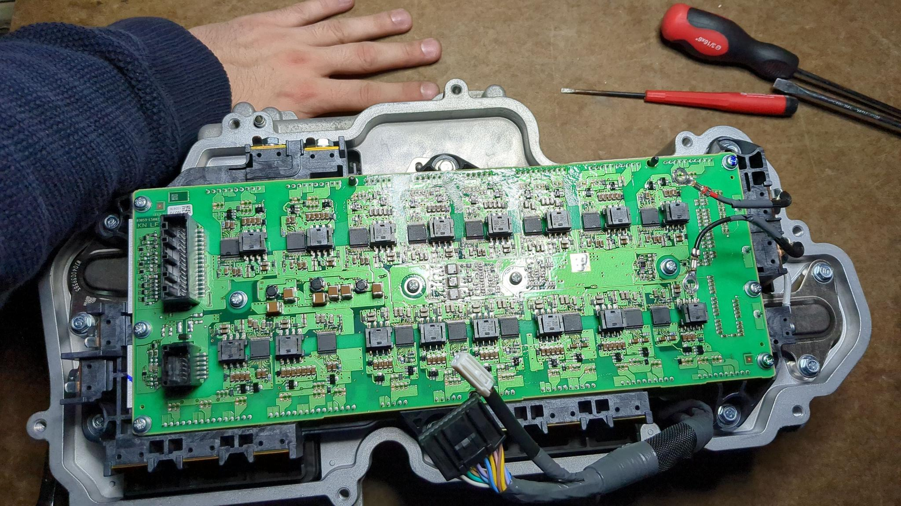
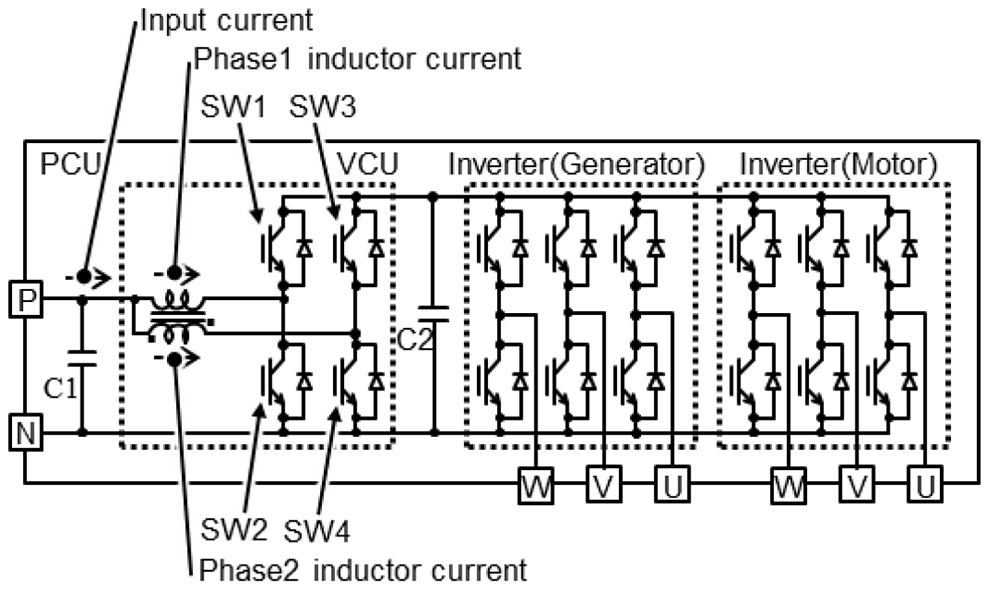

# WIP

## Summary
The Clarity PCU is simple. The control board is an Infineon (Cypress) ARM MCU, controlled components (so far identified) are

- QTY16 ROHM BM60051 gate drivers
- a pre-charge relay
- some temperature sensors
- a battery bus current sensor

## Connections

### Control Unit <=> Power Module
Control -> Power board is QTY1 32-pin cable (probably QTY2 wires per driver), QTY1 12-pin cable.

### Control Unit <=> Outside world
There's a 30-pin connector wired to the other side of the control board.

## Cooling
Almost all the internal space is dry, except for a cooling pipe squashed in the center. I know coolant is one-way, I just don't know which has to be cooler (the copper core or the gates?).

For prototyping, all of the components can be briefly run without coolant.
