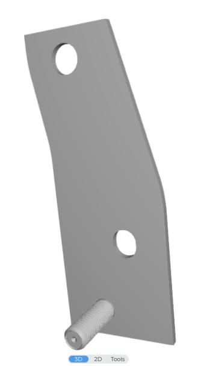

# Pedal mount

## Current solution

Rev 0.1:

> This involves lopping off the left-side mounting nut from the Civic pedal and generally cutting that side down, because there's interference between it and the EPS motor. This bracket is mounted using the original center mounting bolt, then the modified Civic pedal has the stud threaded through and has a longer bolt inserted (probably 95735A425 from McMaster-Carr); finally, a nut is inserted and screwed overtop the stud.

- [This onshape file](https://cad.onshape.com/documents/590f71ba62badff1657387cc/w/6e70f295cc1df24dad0205af/e/1461537d9bda6450f1c55ec0) -- the model Frank -- was sent to SCS on 3 Aug 2024.

- [InsightCentral link](https://www.insightcentral.net/threads/dbw-bolt-pattern-tps-calibration-and-replacement-accelerator-pedal.132893/page-2?post_id=1546917#post-1546917)

## Sources

### OEM accelerator pedal diagramming

- @ttsgeb (Tim Martin) designed [this model](https://cad.onshape.com/documents/590f71ba62badff1657387cc/w/6e70f295cc1df24dad0205af/e/8b86c0843bcfb5d39b51ff20), cloned to [here](https://cad.onshape.com/documents/71996253be2ca9647fe33c3e/w/c8d9d6837a7424c0bdd91621/e/03d794df00421766f12044d6?renderMode=0&uiState=66ae73ea61415b4ebc1988f8) as a writable copy.

