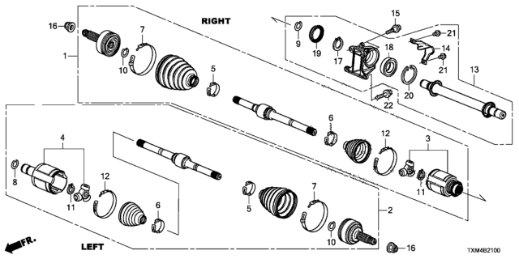
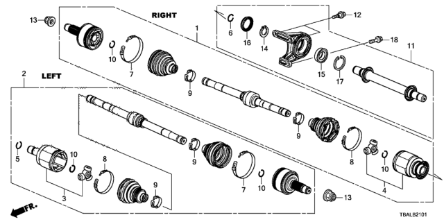
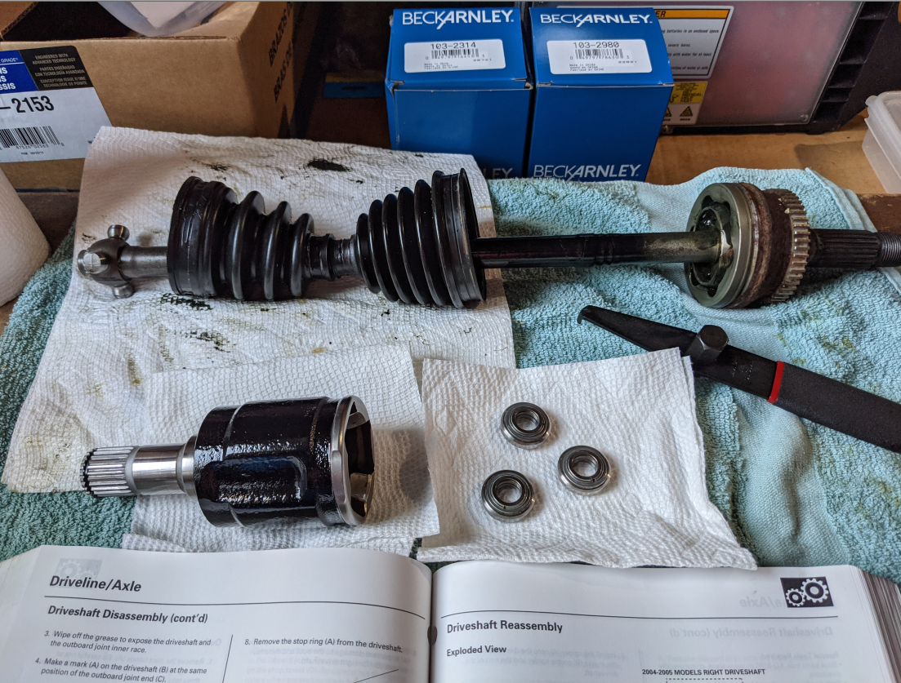
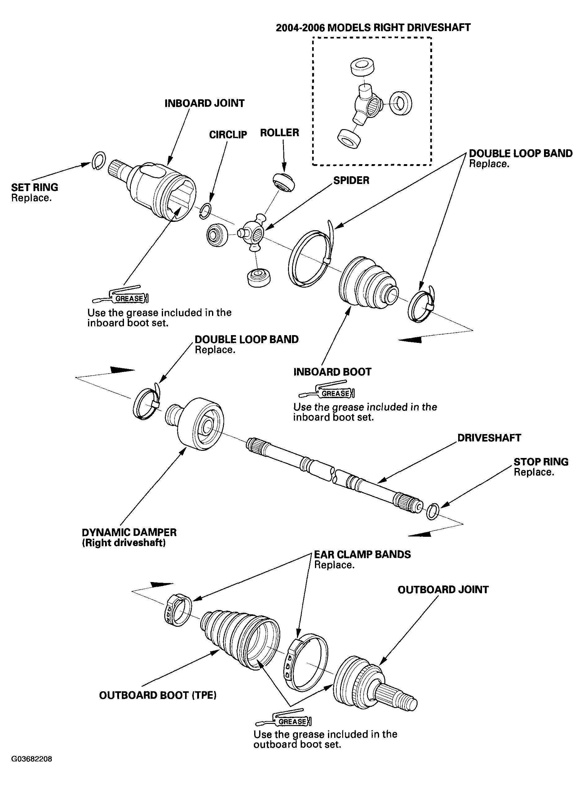

# Other cars

## Clarity
- "Shaft Assembly, R Drive":
- part: 44305-TRW-A01
- [link](https://www.hondapartsnow.com/genuine/honda~driveshaft~assy~r~44305-trw-a01.html?vin=&make=Honda&model=Clarity%20Plug-In%20Hybrid&year=2020&submodel=&extra1=4%20Door%20TRNG%20(CLARITY%20PHEV)&extra2=KA%20CVT&filter=()&location=pd:4241057,1)

## G3 Insight
- "Shaft Assembly, R Drive":
- 44305-TXM-A01

## Modern basemodel Civic
- "Driveshaft Assembly, Passenger Side"
- 44305-TEG-000

## OEM Insight

### Teardown threads

- matt2001's complete teardown: https://www.insightcentral.net/threads/cleaning-the-crud-from-my-cv-joints-what-to-use.128585/?post_id=1488896#post-1488896
 
  No measurements, but GREAT visuals for how the outer joint works -- like a stake into a spider of sorts.

  

- Scott's inner joint rebuild thread: https://www.insightcentral.net/threads/inner-axle-joint.131085/ 

  Demonstrates that only the inner joint lacks a circlip.

- OEM Service manual: 
  
  

  Provides only instructions, no scale.

  Also https://downloads.laboratoryb.org/insight/driveline_axle.pdf#page=14

  Mildly useful, less so than then 
