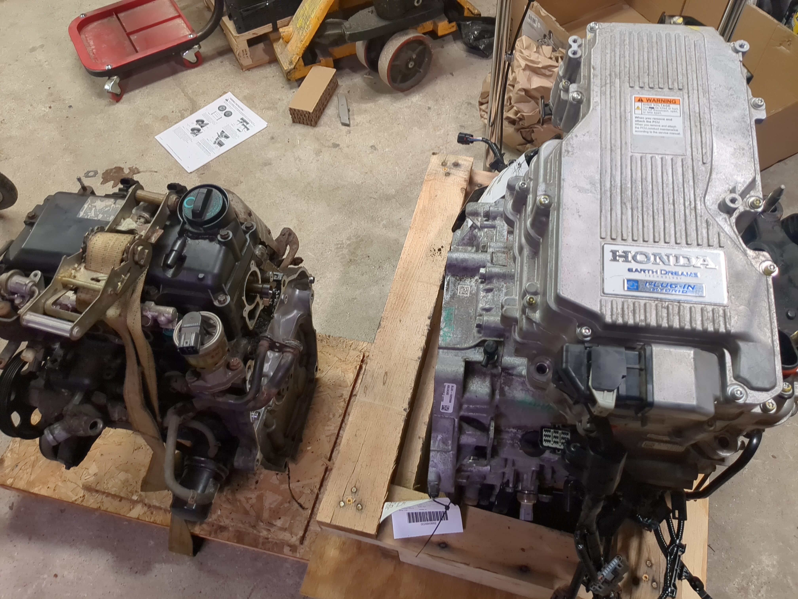

# WIP

## Mounting bolts
Custom lengths needed, I suspect.

## Flywheel
This must be measured, designed and SendCutSent. The jury is out on how different the depths of the engine cranks are from the outside of the housing between the Clarity/Insight LEB and the ECA1, but we can likely ignore those differences by relying on the depth of the input shaft.

## Other problems 
- Rear engine mount: It's possible the oil pan will interfere with mounting the rear engine mount. TBD.

